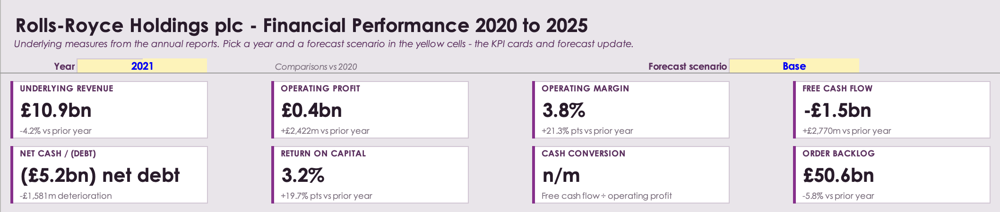
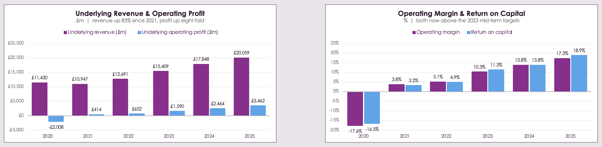
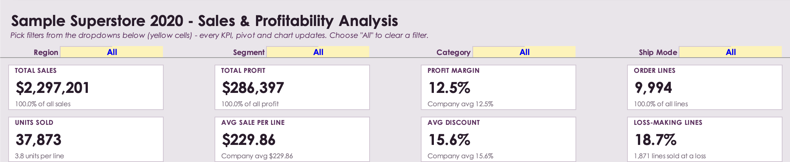
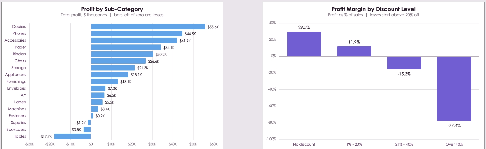

# Rayyaan Akhtar | Accounting & Finance Portfolio

**🔗 Live site: [rayakhtar-projects.github.io/ray-projects](https://rayakhtar-projects.github.io/ray-projects/)**

Accounting & Finance student at the **University of West London**, with a quantitative background from **Physics with Astrophysics at King's College London**. Interested in corporate banking, corporate finance and financial analysis.

This repository holds my portfolio website and the Excel workbooks behind each project.

---

## Projects

### 1. Rolls-Royce Financial Performance Analysis
Post-pandemic turnaround of Rolls-Royce Holdings plc, analysed from its 2020–2025 annual reports, with a five-year operating profit forecast.

| Metric (underlying) | Result |
|---|---|
| Revenue | £10.9bn (2021) → **£20.1bn** (2025), ~16% CAGR |
| Operating margin | -17.6% (2020) → **17.3%** (2025) |
| Return on capital | 11.3% (2023) → **18.9%** (2025) |
| Balance sheet | £5.2bn net debt (2021) → **£1.9bn net cash** (2025) |

- Civil Aerospace generated 52% of 2025 revenue but 62% of operating profit
- Interactive dashboard: pick any year for 8 KPIs vs the prior year, and switch between bear, base and bull forecasts benchmarked against management guidance





**[Read the case study](https://rayakhtar-projects.github.io/ray-projects/project2.html)** · [Download workbook](files/rollsroyce-dashboard.xlsx)

---

### 2. Sales & Profitability Dashboard
Interactive Excel dashboard analysing **9,994 retail order lines ($2.3m sales)**. Four linked filters drive 8 KPI cards, 8 summary tables and 6 charts.



**Key findings**
- Orders discounted above 20% lost **$135k**, wiping out almost half of total profit
- Furniture earned only a **2.5% margin** on $742k of sales (Tables -$17.7k, Bookcases -$3.5k)
- Central's margin (7.9%) was half the West's (14.9%), driven by a 24% average discount
- Three of seventeen sub-categories generated **49.6%** of total profit

**Built with:** SUMIFS / COUNTIFS · INDEX-MATCH-LARGE dynamic ranking · data validation filters · named ranges · custom number formats · chart design



**[Read the case study](https://rayakhtar-projects.github.io/ray-projects/project1.html)** · [Download workbook](files/sales-dashboard.xlsx)

---

## Skills
| Excel & Data | Finance & Accounting | Communication |
|---|---|---|
| SUMIFS, COUNTIFS, INDEX-MATCH | Financial statement analysis | Data visualisation |
| PivotTables & PivotCharts | Ratio analysis (margins, ROCE, cash conversion) | Business reporting |
| Data validation, named ranges | Forecasting | Dashboard design |
| Interactive dashboards | Profitability & pricing analysis | HTML / CSS |

## Repository structure
```
ray-projects/
├── index.html              Portfolio home page
├── project1.html           Sales & Profitability Dashboard case study
├── project2.html           Rolls-Royce Financial Performance case study
├── style.css               Shared stylesheet
├── README.md
├── images/                 Dashboard screenshots
│   ├── sales1.png – sales4.png
│   └── rollsroyce1.png – rollsroyce4.png
└── files/                  Downloads
    ├── CV.pdf
    ├── sales-dashboard.xlsx
    ├── rollsroyce-dashboard.xlsx
    └── superstore-raw-data.xlsx
```

## Contact
- **LinkedIn:** [linkedin.com/in/rayyaan-akhtar](https://www.linkedin.com/in/rayyaan-akhtar)
- **Email:** [ray.akhtar1@outlook.com](mailto:ray.akhtar1@outlook.com)
